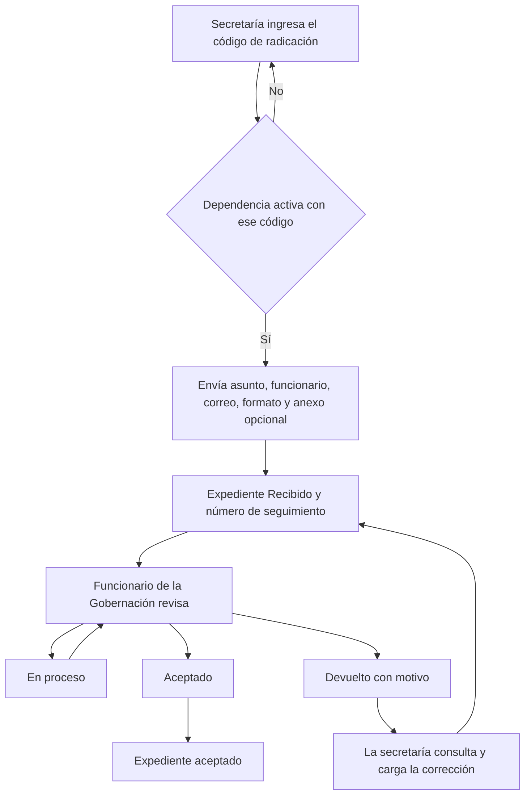

# Análisis de requerimientos — Bancos de proyectos

**Sistema:** SIID 2.0 / Orbit Intelligence  
**Entidad:** Gobernación del Meta  
**Módulo:** Radicación y revisión de formatos de banco de proyectos  
**Fecha:** 28 de noviembre de 2026  
**Estado:** versión operativa construida en esta etapa  

Este documento fija qué debe hacer el módulo, quién lo usa y con qué reglas. Describe el comportamiento ya acordado y construido. No reemplaza el código ni autoriza cambios sobre lo existente.

## 1. Objetivo

Permitir que una secretaría entregue el formato de banco de proyectos a la Gobernación, que el funcionario asignado lo revise, y que la secretaría corrija el mismo expediente cuando se lo devuelvan, sin perder el número de seguimiento ni el historial.

## 2. Necesidad

La secretaría no debe radicar por un canal informal ni perder el rastro cuando el formato se devuelve. La Gobernación necesita:

- saber de qué secretaría llega el formato, mediante un código que ella misma entrega;
- recibir el documento y un anexo opcional;
- entregar un número de seguimiento que no cambia durante toda la vida del expediente;
- que el funcionario vea solo las secretarías que le corresponden;
- dejar constancia de cada decisión y del motivo cuando se devuelve;
- que la secretaría consulte el estado y, si está devuelto, cargue la corrección sobre el mismo número.

## 3. Alcance de esta versión

Entra en esta versión:

- identificación de la secretaría por el código de radicación;
- formulario público de envío;
- número de seguimiento;
- consulta pública por número o por correo;
- revisión interna con los estados Recibido, En proceso, Devuelto y Aceptado;
- devolución con motivo obligatorio;
- corrección de la secretaría sobre el mismo expediente;
- archivos versionados;
- aviso por correo al funcionario de la secretaría;
- vista previa de PDF y descarga directa para quien revisa;
- asignación del código de radicación a cada secretaría;
- creación del usuario del funcionario y asignación de las secretarías que revisa.

Queda fuera de esta versión, y no forma parte del comportamiento actual:

- radicado oficial de correspondencia;
- tipos de formato distintos del formato y del anexo;
- alertas distintas del correo de estado;
- cruce con BPIN o con Gerico;
- creación de secretarías desde la pantalla de códigos de radicación.

La secretaría, como dependencia del catálogo institucional, se crea en el espacio de dependencias. El código que la secretaría escribe en el formulario público se asigna después, en una pantalla aparte.

## 4. Actores

| Actor | Quién es | Qué hace en el módulo |
|---|---|---|
| Funcionario de la secretaría | Persona que radica, sin cuenta en el panel | Identifica su secretaría, envía el formato, consulta el estado y corrige si se lo devuelven |
| Revisor de bancos | Funcionario de la Gobernación con cuenta y rol propio | Ve las solicitudes de las secretarías asignadas, las revisa y cambia el estado |
| Administrador técnico | Administra la plataforma | Crea usuarios, asigna secretarías, asigna códigos y ve todas las solicitudes |
| Gerente de inversión | Administra inversión de todas las dependencias | Asigna códigos de radicación y ve todas las solicitudes |

El revisor de bancos no administra usuarios, no asigna códigos y no ve los demás módulos de la plataforma. Al entrar, llega a la bandeja de solicitudes.

El administrador y el gerente de inversión ven las solicitudes de todas las secretarías. El revisor solo ve las de las dependencias que le asignaron. Si no tiene ninguna, la bandeja queda vacía.

## 5. Conceptos

Hay dos códigos distintos y no se intercambian.

| Concepto | Para qué sirve | Ejemplo |
|---|---|---|
| Código institucional de la dependencia | Identifica la secretaría dentro del catálogo | `SEC-EDU` |
| Código de radicación | Lo escribe la secretaría en el formulario público | `EDUC-META` |
| Número de seguimiento | Identifica un expediente durante toda su vida | `BP-2026-BG95MP` |
| Formato | Documento principal, obligatorio en cada envío | PDF o Word |
| Anexo | Documento complementario, opcional | PDF o Word |
| Versión | Cada envío o corrección conserva sus archivos | 1, 2, 3… |

La secretaría que aparece en el expediente es la dependencia activa cuyo código de radicación coincide con el código ingresado. El nombre de la secretaría queda guardado en la solicitud en el momento del envío.

## 6. Requerimientos funcionales

### RF-01. Identificar la secretaría

El formulario público empieza pidiendo el código de la dependencia.

- El código se normaliza a mayúsculas y sin espacios al inicio o al final.
- Solo corresponde a una dependencia activa que ya tenga código de radicación.
- Si no hay coincidencia, el sistema informa que no encontró una dependencia activa con ese código y no abre el formulario de envío.
- Si hay coincidencia, muestra la secretaría y permite diligenciar el envío.
- El código queda en la sesión de quien diligencia. No se publica en la dirección de la página.
- La persona puede cambiar de código antes de enviar.

### RF-02. Radicar el formato

Con la secretaría identificada, el funcionario de la secretaría envía:

- asunto, hasta 200 caracteres;
- nombre del funcionario, hasta 150 caracteres;
- correo electrónico válido;
- formato obligatorio;
- anexo opcional.

Al guardar:

- el expediente nace en estado **Recibido**;
- recibe un número de seguimiento con la forma `BP-` + año + `-` + seis caracteres;
- ese número no usa caracteres ambiguos (se omiten `I`, `O`, `0` y `1`);
- el número es único;
- el correo se guarda en minúsculas;
- se conserva el archivo del formato y, si vino, el del anexo, como versión 1;
- se envía al correo indicado un aviso con el número de seguimiento;
- la página de confirmación muestra el número. El número no viaja en la URL.

Si el almacenamiento del archivo falla, no queda un expediente a medias y los archivos parciales se retiran.

### RF-03. Consultar el estado

La consulta pública acepta el número de seguimiento o el correo.

- Con el número, muestra el expediente: secretaría, asunto, estado, archivos de la versión vigente, fecha de recepción e historial.
- El número de la consulta queda en la sesión. No se publica en la URL.
- Si el número no existe, informa que no encontró la solicitud.
- Con el correo, no muestra el listado en pantalla. Si ese correo tiene solicitudes, envía un resumen con el estado y el número. El mensaje en pantalla es el mismo exista o no el correo, para no revelar si está registrado.
- El resumen por correo considera hasta las 20 solicitudes más recientes de ese correo.

### RF-04. Revisar el expediente

Quien puede revisar entra a la bandeja y abre el expediente. Ve el documento recibido, la decisión y la trazabilidad.

Puede marcar:

- **En proceso**, cuando ya lo está revisando;
- **Aceptado**, cuando el formato queda aceptado;
- **Devuelto**, cuando la secretaría debe corregirlo.

Reglas de la decisión:

- Devolver exige un motivo de al menos 10 caracteres y máximo 2000.
- En proceso y Aceptado pueden confirmarse sin motivo.
- Cada cambio queda en el historial con el estado anterior, el estado nuevo, la fecha, el funcionario que decidió y la observación, si la hubo.
- Si se intenta dejar el mismo estado, salvo una nueva devolución, no se duplica el evento.
- Al cambiar el estado se avisa por correo al funcionario de la secretaría. Si el correo no sale, el cambio de estado sí queda registrado.

Colores del estado, iguales en la consulta pública y en la revisión:

| Estado | Color |
|---|---|
| Recibido | Azul institucional |
| En proceso | Amarillo |
| Aceptado | Verde |
| Devuelto | Rojo |

### RF-05. Ver y descargar los archivos

En el expediente de revisión, cada archivo ofrece **Descargar**.

Si el archivo es PDF, también ofrece **Vista previa**. La vista previa se abre al centro de la pantalla, en cualquier tamaño de ventana, y permite pasar páginas. La descarga directa sigue disponible junto a la vista previa.

Un Word, u otro archivo que no sea PDF, solo ofrece descarga. La vista previa en línea solo se entrega si el archivo termina en `.pdf`, su tipo es PDF y su contenido empieza como PDF. En caso contrario, la petición en línea se rechaza.

Quien no tenga permiso para ver esa solicitud no descarga el archivo. Quien no haya iniciado sesión es enviado al inicio de sesión.

### RF-06. Corregir sobre el mismo número

La corrección solo se habilita cuando el estado es **Devuelto**.

La secretaría carga un formato nuevo, obligatorio, y puede cargar un anexo nuevo. El sistema:

- conserva el mismo número de seguimiento, la misma secretaría, el mismo asunto, el mismo nombre y el mismo correo;
- guarda los archivos nuevos como una versión siguiente y conserva las versiones anteriores;
- deja el estado otra vez en **Recibido**;
- registra el evento «La secretaría cargó una corrección.»;
- avisa por correo que la corrección volvió a revisión;
- muestra en la consulta el motivo de la devolución mientras el expediente siga devuelto.

Si el estado ya no es Devuelto, el sistema rechaza la corrección.

### RF-07. Asignar el código de identificación a cada secretaría

En **Códigos de radicación** el administrador o el gerente de inversión asigna o cambia el código de radicación de una dependencia que ya existe.

- El código tiene entre 4 y 20 caracteres.
- Solo admite letras, números y guiones.
- Se guarda en mayúsculas.
- Es único entre dependencias.
- Dejarlo vacío lo retira: esa secretaría deja de poder radicar hasta que tenga otro código.
- La dependencia debe estar activa para que el código sirva en el formulario público.
- Esta pantalla no crea secretarías.

La secretaría se crea antes, en el catálogo de dependencias, con su código institucional, nombre y sigla. Ese código institucional no se usa en el formulario público.

### RF-08. Crear el usuario del funcionario y asignarle secretarías

El administrador o el gerente crean la cuenta en **Equipo y permisos**.

- Nombre, correo, rol, cuenta activa y contraseña inicial.
- La contraseña inicial tiene al menos 12 caracteres y se confirma.
- El rol del funcionario de este módulo es **Revisor de bancos**.
- Al elegir ese rol se muestran las dependencias. Se pueden asignar una o varias.
- La lista de dependencias se identifica con el código institucional y el nombre.
- Después de creada, la cuenta solo ve las solicitudes de esas dependencias.
- La contraseña se puede restablecer después, con la misma longitud mínima.

## 7. Reglas de negocio

1. Una solicitud pertenece a una sola secretaría.
2. El número de seguimiento nace con el primer envío y no cambia al corregir.
3. Solo se corrige un expediente devuelto.
4. La devolución sin motivo, o con un motivo de menos de 10 caracteres, no se guarda.
5. El formato es obligatorio en el envío y en la corrección. El anexo es opcional.
6. Cada archivo es PDF o Word (`.pdf`, `.doc`, `.docx`) y no supera 10 MB.
7. Los archivos de versiones anteriores permanecen consultables en la revisión.
8. Un código de radicación pertenece como máximo a una dependencia.
9. Una dependencia inactiva, o sin código de radicación, no puede identificarse en el formulario público.
10. El revisor sin dependencias asignadas no ve solicitudes ajenas.
11. El fallo del correo no deshace la radicación, la corrección ni el cambio de estado.

## 8. Flujo principal

## 9. Información que se conserva

Por solicitud: número de seguimiento, referencia interna, secretaría, asunto, nombre del funcionario, correo, estado, archivo vigente y fecha de creación.

Por archivo: versión, clase (formato o anexo), nombre original, tipo, tamaño y ruta de almacenamiento. El almacenamiento es privado. No se publica una URL abierta del archivo.

Por evento: estado de origen, estado de destino, observación, usuario que decidió (vacío cuando actúa la secretaría) y fecha.

Por dependencia, para este módulo: código institucional, nombre, sigla, si está activa y código de radicación.

Por usuario revisor: nombre, correo, rol, si la cuenta está activa, contraseña y dependencias asignadas.

## 10. Requerimientos no funcionales

- El formulario público no exige cuenta. La revisión, la descarga y la administración sí.
- La identificación pública se limita a 10 intentos por minuto. El envío y la corrección, a 5 por minuto. La consulta, a 10 por minuto.
- El número de seguimiento y el código de la secretaría no se colocan en la URL pública.
- La consulta por correo no confirma si el correo existe.
- La vista previa no incrusta el archivo en un marco. Lo dibuja en la página, de modo que una política que prohíba marcos no impida ver el PDF.
- La vista previa queda centrada con independencia del tamaño de la pantalla.
- La interfaz pública y la de revisión usan la presentación institucional ya definida: azul `#0943b5`, encabezado oscuro, línea verde y los colores de estado de la sección RF-04.
- El revisor no ve la tarjeta de módulos disponibles. Su inicio es la bandeja.
- Los avisos de correo se intentan en el momento del hecho. Un fallo de correo se registra y no revierte la operación.

## 11. Pantallas

| Pantalla | Dirección | Quién entra |
|---|---|---|
| Radicar | `/solicitud-banco` | Secretaría, sin cuenta |
| Consultar y corregir | `/solicitud-banco/consultar` | Secretaría, sin cuenta |
| Ingreso al panel | `/login` | Funcionarios con cuenta |
| Bandeja | `/gestion/solicitudes-banco` | Revisor, administrador y gerente de inversión |
| Expediente | `/gestion/solicitudes-banco/{id}` | Quien pueda ver esa solicitud |
| Códigos de radicación | `/gestion/codigos-radicacion` | Administrador y gerente de inversión |
| Equipo y permisos | `/gestion/usuarios` | Administrador y gerente |
| Dependencias | `/gestion/espacios/dependencias` | Quien administra el catálogo |

## 12. Criterios de aceptación

1. Con un código de radicación vigente, la secretaría envía el formato y recibe un número `BP-año-xxxxxx`.
2. Con un código inexistente, inactivo o vacío, no se crea la solicitud.
3. El revisor asignado ve esa solicitud. Un revisor de otra secretaría no la ve ni la descarga.
4. En proceso se muestra amarillo, Aceptado verde y Devuelto rojo, en la consulta y en la revisión.
5. Devolver sin un motivo de al menos 10 caracteres no cambia el estado.
6. Con el expediente devuelto, la secretaría carga la corrección, el número sigue igual, el estado vuelve a Recibido y el historial conserva la devolución y la corrección.
7. Con el expediente en otro estado, la corrección se rechaza.
8. Un PDF del expediente ofrece vista previa centrada y descarga. Un Word solo ofrece descarga.
9. Dos secretarías no pueden compartir el mismo código de radicación.
10. Un usuario Revisor de bancos, con contraseña inicial de al menos 12 caracteres y una o más secretarías, entra y solo opera esas secretarías.

## 13. Preparación operativa

Antes de que una secretaría radique hacen falta tres datos, en este orden:

1. La dependencia existe y está activa, con su código institucional, nombre y sigla.
2. Tiene un código de radicación único, que es el que se le entrega a la secretaría.
3. El funcionario de la Gobernación tiene usuario, contraseña y esa secretaría asignada.

Sin el paso 2 la secretaría no puede identificarse. Sin el paso 3 nadie de esa secretaría aparece en la bandeja del revisor. El administrador y el gerente de inversión sí siguen viendo todas las solicitudes.
